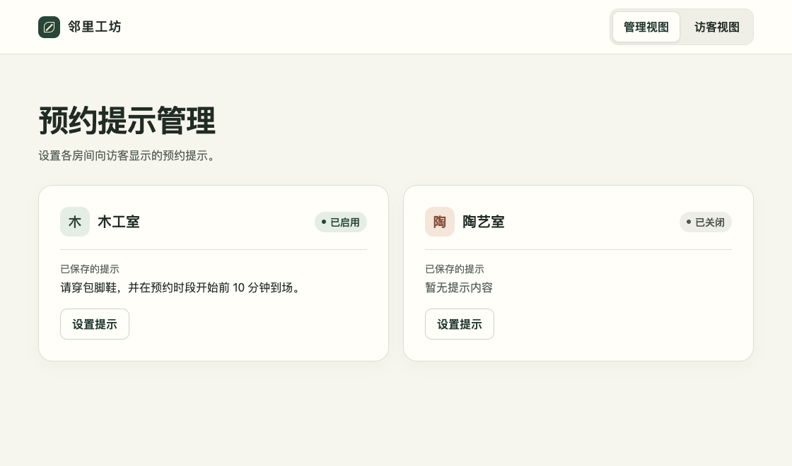

# HTML Prototype Skill

[](https://github.com/osborn001/html-prototype-skill/actions/workflows/verify.yml)

[中文说明](README.md)

Turn product requirements into a clickable, offline, single-file HTML prototype. Use the skill to design a new flow, make a scoped change to an existing screen, or verify the shipped artifact in a browser. The package follows the [Agent Skills specification](https://agentskills.io/specification).

## Install

From your project, run the Skills CLI and select your agent. It requires Node.js 22.20 or later. Add `-g` for a user-wide install. [Skills CLI documentation](https://github.com/vercel-labs/skills#install-a-skill)

```sh
npx skills add osborn001/html-prototype-skill --skill html-prototype
```

If auto-detection picks another client, add `--agent codex`, `--agent claude-code`, `--agent cursor`, or `--agent opencode`.

For a manual setup, copy the entire `html-prototype/` folder into a supported skills directory. [Windows PowerShell and macOS/Linux instructions](README.md#手动安装)

| Agent | Project location | User location |
|---|---|---|
| Codex | `.agents/skills/` | `~/.agents/skills/` |
| Claude Code | `.claude/skills/` | `~/.claude/skills/` |
| Cursor | `.agents/skills/` | `~/.agents/skills/` |
| OpenCode | `.agents/skills/` | `~/.agents/skills/` |

For other agents that support the Agent Skills format, use the location specified by that agent. Agents with file access can also read [SKILL.md](html-prototype/SKILL.md) directly.

## Try it

> Use html-prototype to build a booking prototype for a fictional community workshop. Managers can set a booking notice for each room. Visitors only see the active notice for their selected room. Demonstrate saving, discarding and disabling a notice, and deliver one HTML file that runs offline.

The [runnable example and verification steps](examples/README.md) use fictional data. The optional [Python resource checker](html-prototype/scripts/check_offline.py) can flag common separate dependencies. Use a browser to verify visual behavior and exercise the interactions.


