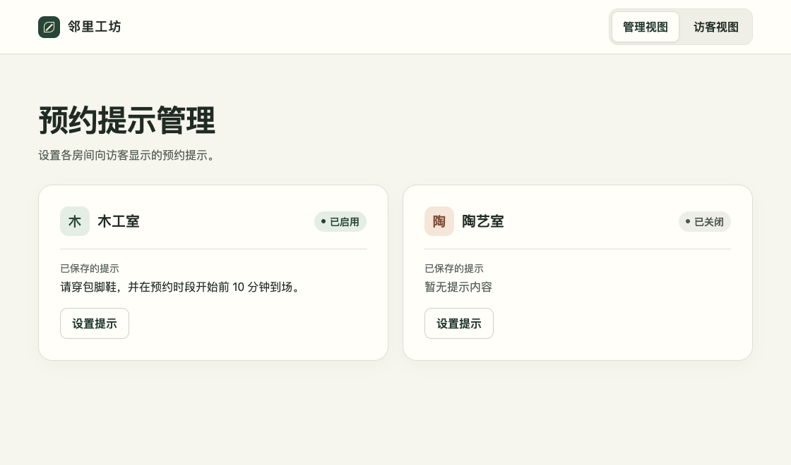

# HTML Prototype Skill

[](https://github.com/osborn001/html-prototype-skill/actions/workflows/verify.yml)

[English guide](README.en.md)

把需求做成**可点击、可离线打开的单文件 HTML 产品原型**。这个 Skill 遵循 [Agent Skills 开放规范](https://agentskills.io/specification)，适用于支持该格式的 Agent。整个 Skill 是一个目录，按需读取参考和脚本。

| 任务 | 产出 |
|---|---|
| 从需求做新原型 | 用户能从入口走到结果，关键状态可触发 |
| 在原页面上做局部迭代 | 先还原或复用原页面，再加功能。同视口检查原图、基线稿与迭代稿 |
| 验收现有原型 | 验证保存、回显、取消和数据联动，核对单文件离线交付 |

## 安装

### 用 Skills CLI 安装

在工作项目里运行以下命令，选择正在使用的 Agent。需要 Node.js 22.20 或以上版本。默认装到当前项目，追加 `-g` 可安装到用户范围。[Skills CLI 安装文档](https://github.com/vercel-labs/skills#install-a-skill)

```sh
npx skills add osborn001/html-prototype-skill --skill html-prototype
```

若工具自动选中了其他客户端，可追加 `--agent codex`、`--agent claude-code`、`--agent cursor` 或 `--agent opencode`。

### 手动安装

下载仓库 ZIP 并解压。把整个 `html-prototype/` 文件夹复制到客户端的 Skills 目录，确认最终结构是 `skills/html-prototype/SKILL.md`。已有同名版本时先备份，再替换整个目录。

| 客户端 | 项目目录 | 用户目录 |
|---|---|---|
| Codex | `.agents/skills/` | `~/.agents/skills/` |
| Claude Code | `.claude/skills/` | `~/.claude/skills/` |
| Cursor | `.agents/skills/` | `~/.agents/skills/` |
| OpenCode | `.agents/skills/` | `~/.agents/skills/` |
| 其他兼容 Agent | 以客户端支持的 Skills 目录为准 | 以客户端支持的 Skills 目录为准 |

`~` 代表运行 Agent 的用户目录。在 Windows 原生客户端或 WSL 里使用时，分别按对应环境的用户目录安装。[Codex](https://learn.chatgpt.com/docs/build-skills#where-codex-loads-local-skills) · [Claude Code](https://code.claude.com/docs/en/skills#choose-where-skills-load) · [Cursor](https://cursor.com/docs/skills#skill-directories) · [OpenCode](https://opencode.ai/docs/skills/#discovery)

以下命令假定当前目录下有解压得到的 `html-prototype/`。要装到另一个项目，可在目标项目中执行，并把源路径换成解压后该文件夹的绝对路径。Claude Code 把命令里的 `.agents/skills` 改成 `.claude/skills`。

**Windows PowerShell**

```powershell
$skillRoot = '.agents/skills'
$destination = Join-Path $skillRoot 'html-prototype'
if (Test-Path -LiteralPath $destination) { throw 'html-prototype already exists' }
New-Item -ItemType Directory -Path $skillRoot -Force -ErrorAction Stop | Out-Null
Copy-Item -LiteralPath './html-prototype' -Destination $destination -Recurse -ErrorAction Stop
```

**macOS / Linux / WSL**

```sh
skill_root=".agents/skills"
destination="$skill_root/html-prototype"
if [ -e "$destination" ] || [ -L "$destination" ]; then
  printf '%s\n' 'html-prototype already exists' >&2
else
  mkdir -p "$skill_root" && cp -R ./html-prototype "$destination"
fi
```

## 试一次

在 Agent 里通过技能选择器选中 `html-prototype`，或直接在提示中点名。Codex 可输入 `$html-prototype`，Claude Code 可输入 `/html-prototype`。仅支持读取项目文件的 Agent，也可直接请它阅读 `html-prototype/SKILL.md` 并按其中的流程执行。

> 使用 html-prototype 做一份社区工坊预约原型。管理员可以分别设置木工室和陶艺室的预约提示，访客只看到选中房间启用后的提示。演示保存、取消、停用与分房间生效，交付能离线打开的单文件 HTML。

[示例需求与验收步骤](examples/README.md) · [示例 HTML 源文件](examples/workshop-booking.html)



## 本地验证

独立的 Python 检查器可找出常见的外链脚本、样式、字体和图片。本体是 Markdown，启用 Skill 无需安装 Python 或浏览器测试依赖。

```sh
python3 html-prototype/scripts/check_offline.py examples/workshop-booking.html
python3 -B -m unittest discover -s tests -v
```

Windows 可将 `python3` 换成 `py -3`。浏览器可复跑步骤见[示例验收](examples/README.md)。
